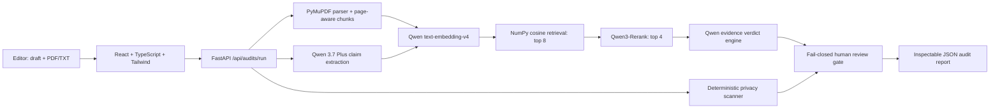

# ProofPilot

ProofPilot is an evidence-first audit agent for AI-assisted public content. It
compares a draft with its original PDF or text source, retrieves the strongest
evidence for every factual claim, identifies contradictions and unsupported
claims, scans for privacy risks, and pauses unsafe content for human review.

Built for the **Global AI Hackathon Series with Qwen Cloud**, Track 4:
**Autopilot Agent**.

## Why it is different

- Exact source quotes and page-aware citations instead of an unexplained score
- A real RAG pipeline: chunking → embeddings → cosine retrieval → reranking
- Five explicit verdicts: supported, weak support, unsupported, contradicted,
  and human review required
- Deterministic privacy scanning runs beside the AI pipeline
- Invalid or invented evidence quotes automatically fail closed to human review
- One-click pdf audit report for an inspectable decision trail

## Architecture



## Technology

- Frontend: React 19, TypeScript, Vite, Tailwind CSS
- API: Python 3.11, FastAPI, Pydantic
- Documents: PyMuPDF with page-aware overlapping chunks
- RAG: Qwen `text-embedding-v4`, NumPy cosine similarity, Qwen
  `qwen3-rerank`
- Reasoning: Qwen `qwen3.6-flash` structured JSON output
- Deployment: multi-stage Docker container, ready for Alibaba Cloud Container
  Registry and Function Compute

No model training or private training dataset is required. Uploaded source
documents become temporary retrieval context for that audit only.

## Evaluation

On the included transparent 12-claim synthetic benchmark, ProofPilot achieved:

- **100% verdict accuracy** (12/12)
- **100% retrieval Recall@4** (12/12)
- **50% retrieval Recall@1** (6/12)

These are hackathon smoke-test results, not production-scale claims. The cases,
expected labels, runner, and recorded result are all in `evaluation/`.

The six-claim reference demo completed in **41.1 seconds** locally after
combining embedding batches and skipping unnecessary reranking for a
single-chunk source. Actual latency varies with network and provider load.

## Run locally

1. Configure the backend:

```bash
cd backend
python3.11 -m venv .venv
source .venv/bin/activate
pip install -r requirements-dev.txt
cp .env.example .env
```

Add your Qwen Cloud key to `backend/.env`. Never commit that file.

2. Start the API:

```bash
fastapi dev main.py
```

3. In a second terminal, start the website:

```bash
cd frontend
npm install
npm run dev
```

Open `http://localhost:5173`, choose **Load demo**, then **Run full audit**.
API documentation is available at `http://127.0.0.1:8000/docs`.

## Tests

```bash
cd backend
source .venv/bin/activate
pytest -q

cd ../frontend
npm run build
npm run lint
```

## Container

The production container builds the frontend and serves it from FastAPI:

```bash
docker build -t proofpilot .
docker run --rm -p 9000:9000 \
  -e DASHSCOPE_API_KEY=your-key \
  proofpilot
```

Then open `http://localhost:9000`.

## Safety and privacy

ProofPilot is a decision-support tool, not an automatic publisher. It does not
persist uploaded files or audit results. High-risk or unverifiable findings
block publication until a person reviews them. The public demo should not be
used with confidential, regulated, or legally privileged data.

## License

MIT
