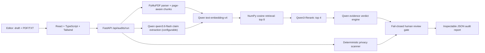

# ProofPilot

ProofPilot is an evidence-first audit agent for AI-assisted public content. It
compares a draft with its original PDF or text source, retrieves the strongest
evidence for every factual claim, identifies contradictions and unsupported
claims, scans for privacy risks, and pauses unsafe content for human review.

Built for the **Global AI Hackathon Series with Qwen Cloud**, Track 4:
**Autopilot Agent**.

## Why it is different

- Exact source quotes and page-aware citations instead of an unexplained score
- A real RAG pipeline: chunking → embeddings → cosine retrieval → reranking
- Five explicit verdicts: supported, weak support, unsupported, contradicted,
  and human review required
- Deterministic privacy scanning runs beside the AI pipeline
- Invalid quotes, unknown citations, and unsupported numeric coverage require human review
- One-click PDF audit report and inspectable JSON API responses

## Architecture



## Technology

- Frontend: React 19, TypeScript, Vite, Tailwind CSS
- API: Python 3.11, FastAPI, Pydantic
- Documents: PyMuPDF with page-aware overlapping chunks
- RAG: Qwen `text-embedding-v4`, NumPy cosine similarity, Qwen
  `qwen3-rerank`
- Reasoning: Qwen `qwen3.6-flash` structured JSON output
- Deployment: multi-stage Docker container, ready for Alibaba Cloud Container
  Registry and Function Compute

No model training or private training dataset is required. Uploaded source
documents become temporary retrieval context for that audit only.

## Evaluation

The main benchmark now uses **400 upstream expert-annotated SciFact claims**:
100 development and 300 fixed test claims, with **16 candidate abstracts per
case** and no shared source documents between the splits. Separate synthetic
policy examples cover all five application verdicts. See the
[evaluation guide](evaluation/README.md) and
[data attribution and licenses](evaluation/datasets/scifact-v2/ATTRIBUTION.md).

The complete 300-case test retrieval comparison produced:

| Method | Recall@1 | Recall@4 |
| --- | ---: | ---: |
| Offline BM25 | 63.87% | 81.83% |
| MiniLM cosine | 69.33% | 92.25% |
| MiniLM cross-encoder | 80.01% | 94.47% |

Recall averages labeled-abstract coverage over the **188 evidence-bearing
claims**, in controlled 16-abstract pools. The other 112 claims have no annotated
retrieval target. These figures measure retrieval, not verdict accuracy.

The runner compares embedding-only retrieval with the production reranking
policy on identical cached embeddings and reports per-label verdict metrics,
confidence intervals, evidence rankings, missing outputs, fallback counts, and
model/code/dataset provenance. The hosted Qwen preflight encountered an exhausted
free quota. A separate free Colab profile has completed a ten-case development
pilot using open weights; its partial report is recorded in
`evaluation/reports/colab-development-pilot-10.json`. The full 100-case development
run achieved **50% exact-label verdict accuracy** (macro F1 0.5842), with no missing
outputs or observed false-supported predictions. It was conservative: 21 claims
received weak support and 14 required human review. A separate three-class NLI
diagnostic achieved **65.67% test accuracy on all 300 claims**, with 22
false-supported outputs; its label policy differs from the application.
The final five-verdict Qwen test
report is still pending. A verified **50/300 checkpoint** has now been recovered
from the executed notebook and can resume the remaining 250 cases.
These measured limitations matter alongside retrieval performance.

```bash
cd backend
# No key or network required:
python benchmark.py run --dataset ../evaluation/datasets/scifact-v2/test.json \
  --mode lexical --output ../evaluation/reports/my-baseline.json

# Requires working Qwen access; start with development:
python benchmark.py run --dataset ../evaluation/datasets/scifact-v2/development.json \
  --mode compare --verdicts --output ../evaluation/reports/my-model-development.json
```

The original 12-claim scores remain archived in `evaluation/results.json`;
they are smoke-test history, not the headline quality evidence. Candidate pools
include known evidence plus hard negatives, so results do not represent
full-corpus retrieval. Public test data may have appeared in model pretraining.

## Free cloud notebook

Use [the Colab notebook](colab/ProofPilot_Free_Colab.ipynb) with its matching
backend/data bundle to run open-weight models on a free Colab GPU. No paid
inference API key or laptop model installation is required. The notebook starts
with a ten-case development pilot. It supports Google Drive storage and a native
session-upload fallback with exportable checkpoints. Free GPU availability is
limited. See [setup, model differences, and checkpoint recovery](colab/README.md).

Generate the matched notebook and source/data archive before uploading them to
Colab, and regenerate both after changing code or data. This packaging step uses
only Python's standard library and does not load models on your laptop:

```bash
python scripts/build_colab.py
```

## Run locally

1. Configure the backend:

```bash
cd backend
python3.11 -m venv .venv
source .venv/bin/activate
pip install -r requirements-dev.txt
cp .env.example .env
```

Add your Qwen Cloud key to `backend/.env`. Never commit that file.

2. Start the API:

```bash
fastapi dev main.py
```

3. In a second terminal, start the website:

```bash
cd frontend
npm install
npm run dev
```

Open `http://localhost:5173`, choose **Load demo**, then **Run full audit**.
API documentation is available at `http://127.0.0.1:8000/docs`.

## Tests

```bash
cd backend
source .venv/bin/activate
pytest -q

cd ../frontend
npm run build
npm run lint
```

## Container

The production container builds the frontend and serves it from FastAPI:

```bash
docker build -t proofpilot .
docker run --rm -p 9000:9000 \
  -e DASHSCOPE_API_KEY=your-key \
  proofpilot
```

Then open `http://localhost:9000`.

## Safety and privacy

ProofPilot is a decision-support tool. The server does not persist uploaded
files or audit results; document excerpts and draft claims are sent to Qwen for
processing. The browser stores the six most recent reports, including quoted
source passages, in local storage for its existing history feature. Avoid
confidential material on a shared device or public demo.

Missing/duplicate verdicts, invalid citations, non-exact quotes, and missing
numeric coverage in supported claims require human review. Quote checks validate
source presence, not logical entailment. All non-supported verdicts block
publication; a supported report still requires final editor review. No extracted
claims means the draft has not been verified and is blocked. Drafts that reach
the 12-claim extraction cap are rejected with a request to split the draft, rather
than presenting a potentially truncated audit as complete. Reranker outages are
reported explicitly when cosine fallback is used.

## License

MIT
